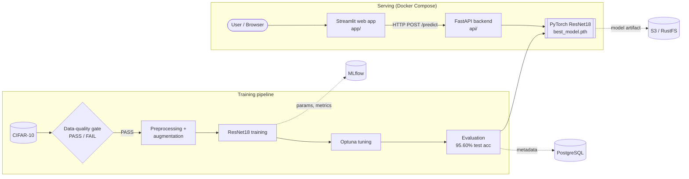

# VisionIQ ML Platform

An end-to-end computer-vision ML platform: data-quality checks, PyTorch transfer learning,
augmentation experiments, Optuna tuning, MLflow tracking, model validation, a FastAPI inference
service, a Streamlit web app, PostgreSQL metadata, S3-compatible storage and Docker.

> This demo uses a model trained on the CIFAR-10 benchmark dataset. Predictions are limited to the
> supported CIFAR-10 classes and are intended for demonstration purposes.

## Architecture


## Results (measured)

All numbers come from runs on a laptop GPU (NVIDIA GTX 1650 Ti), seed 42.

**Data quality** (`python -m src.data.quality`)

| Split | Images | Corrupted | Exact duplicates (SHA-256) | Class balance | Outliers | Status |
|---|---|---|---|---|---|---|
| Train | 50,000 | 0 | 0 | 1.0 (5,000/class) | 2 | PASS |
| Test | 10,000 | 0 | 0 | 1.0 (1,000/class) | 1 | PASS |

**Augmentation experiments** (2 epochs each, only the augmentation changes)

| Experiment | Augmentation | Train acc | Val acc |
|---|---|---|---|
| A | none | 96.4% | 93.86% |
| B | standard | 91.6% | 93.50% |
| C | strong | 81.1% | 91.32% |

With only 2 epochs, augmentation did not help yet: it makes training harder and pays off with
longer training. A shows a train/val gap (early overfitting); B and C do not.

**Hyperparameter search** (Optuna, 5 trials, 1 epoch on 10k images): best val macro F1 0.8878 with
learning rate 8.5e-5, batch size 32, weight decay 6.4e-3, dropout 0.08.

**Final model** (tuned settings, standard augmentation, 5 epochs, 45k training images),
evaluated once on the 10,000-image CIFAR-10 test set:

| Metric | Value |
|---|---|
| Accuracy | 95.60% |
| Macro F1 | 0.9561 |
| ROC-AUC (one-vs-rest) | 0.9987 |

The final model differs from the experiments in several ways at once (tuned settings and more
epochs), so its gain is not attributable to tuning alone. The most common confusion is cat vs dog.

**Confidence threshold** (answer "unknown" below 0.90):

| Threshold | Test images answered | Accuracy on those |
|---|---|---|
| none | 100% | 95.60% |
| 0.90 | 89.0% | 98.94% |

## Features

- Data-quality gate: corruption, SHA-256 duplicates, class balance, channel statistics, outliers, PASS/WARNING/FAIL
- ResNet18 transfer learning (ImageNet weights), AdamW, cosine schedule, checkpointing
- Augmentation experiments and Optuna tuning (objective: validation macro F1)
- MLflow experiment tracking (parameters, per-epoch metrics, artifacts)
- Evaluation: accuracy, macro precision/recall/F1, ROC-AUC, confusion matrix, sanity checks
- Model metadata (`models/best_model_metadata.json`) with version, settings, seed and MLflow run ID
- FastAPI: `/health`, `/model-info`, `/predict` with type, size and decode validation
- Streamlit web app that calls the API (no model code in the frontend)
- SQLAlchemy metadata DB (SQLite locally, PostgreSQL via `DATABASE_URL`)
- S3-compatible storage via boto3 (local folder by default, RustFS/AWS S3 via `S3_*` variables)
- Docker Compose: backend, frontend, PostgreSQL, S3 storage
- pytest tests for data quality, model and API

## Quick start

```bash
python -m venv .venv
.venv\Scripts\activate
pip install torch torchvision --index-url https://download.pytorch.org/whl/cu118   # or the CPU build
pip install -r requirements-api.txt -r requirements-frontend.txt mlflow optuna scikit-learn matplotlib sqlalchemy psycopg2-binary boto3 pytest

python -m src.data.quality                       # data-quality report
python -m src.training.tune                      # Optuna search
python -m src.training.train --params reports/best_params.json --policy standard --epochs 5 --run-name best_model
python -m src.evaluation.evaluate                # test-set metrics and confusion matrix
python -m pytest -v                              # tests
mlflow ui --backend-store-uri sqlite:///mlruns/mlflow.db
```

Run the API and web app locally:

```bash
uvicorn api.app:app --port 8000          # http://localhost:8000/docs
streamlit run app/streamlit_app.py       # http://localhost:8501
```

## Docker

```bash
docker compose up --build
```

Frontend http://localhost:8501, API http://localhost:8000/docs. PostgreSQL is exposed on port 5433
and S3 storage on port 9000. The trained model is mounted from `./models`.

## Project structure

```
api/        FastAPI app and response schemas
app/        Streamlit web app
configs/    config.yaml (all settings)
src/data/   loading, preprocessing, augmentation, data quality
src/models/ ResNet18 model
src/training/  training loop, MLflow, Optuna
src/evaluation/ metrics, sanity checks, threshold analysis
src/database/  SQLAlchemy tables and recording
src/storage/   S3 / local storage
tests/      pytest tests
reports/    generated reports (quality, metrics, confusion matrix)
```

## Limitations

- CIFAR-10 is a benchmark of 32x32 images in 10 classes; accuracy on real-world photos is not measured.
- The model always chooses one of the 10 classes; the 0.90 threshold reduces but does not remove wrong answers on unrelated images.
- Augmentation means controlled transformations of real images, not generative synthetic data.
- Single-seed experiments with short training; small differences are not statistically established.
- Not suitable for safety-critical decisions. Not publicly deployed yet.

## Future improvements

Cloud deployment, CI with GitHub Actions, a proper out-of-distribution detector, multi-seed
experiments, MLflow Model Registry, drift monitoring, and automated retraining.

## License

MIT
